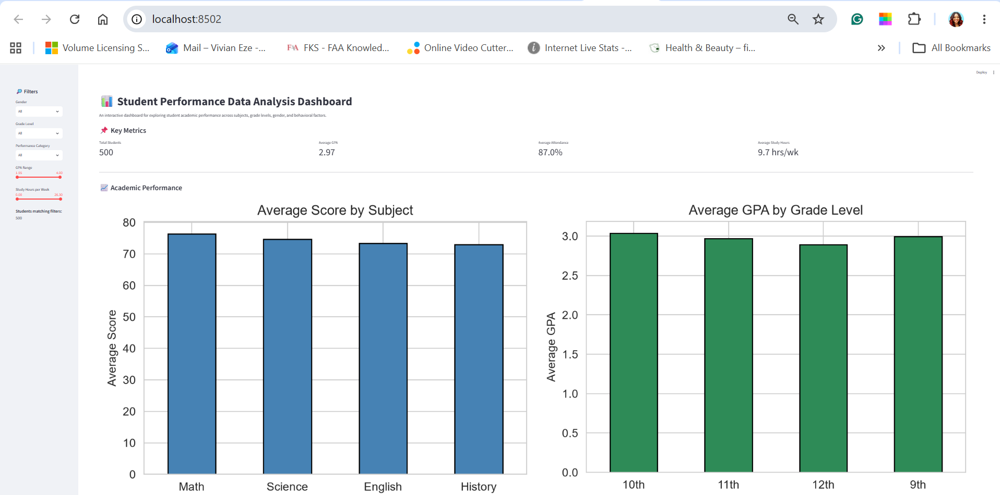
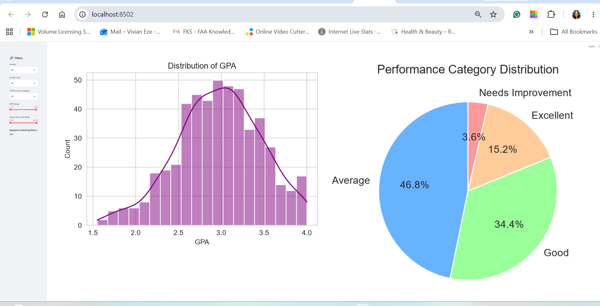
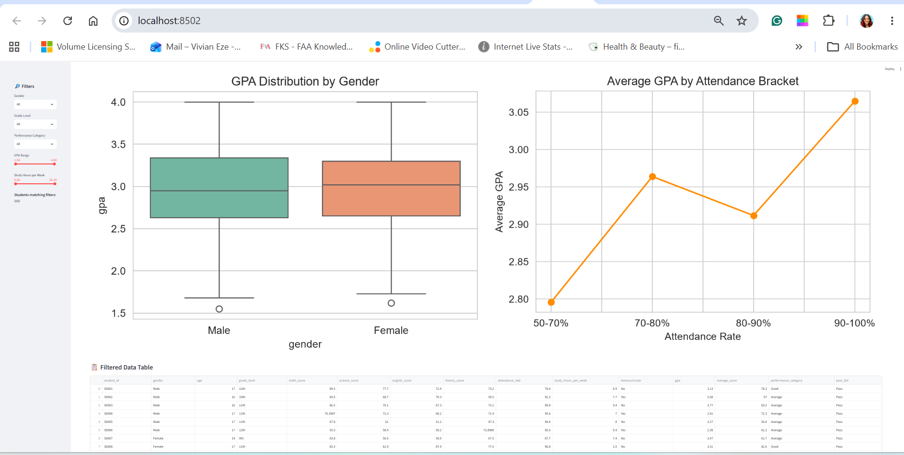

## Student Performance Data Analysis Tool

## Overview
As a software engineer, I am continually working to expand my ability to build data-driven applications. Understanding how to load, clean, analyze, and visualize data is an essential skill for creating software that delivers real insight rather than just raw output. This project represents my effort to strengthen my proficiency in Python-based data analysis and interactive dashboard development using industry-standard libraries such as pandas, NumPy, matplotlib, seaborn, and Streamlit.

The software I created is a Student Performance Data Analysis Tool written in Python. It loads student academic data from a CSV file, cleans and prepares the data, performs exploratory data analysis, generates a series of visualizations, produces a written summary report of key findings, and provides an interactive Streamlit dashboard for exploring the data dynamically. The tool handles real-world data issues such as missing values, duplicate records, and inconsistent data types, then applies statistical analysis to uncover trends related to gender, grade level, attendance, study habits, and academic outcomes.

My purpose for creating this software was to learn how to build a complete data analysis pipeline from end to end — from raw data to interactive visualization. Rather than only running isolated pandas commands, I wanted to design a structured, modular program that mirrors how a professional data analyst or data engineer would approach a real dataset. This includes generating a realistic dataset, cleaning it programmatically, computing grouped aggregates and correlations, producing publication-quality charts, writing a summary report for non-technical audiences, and building an interactive dashboard that lets users explore the data themselves through filters and live-updating visualizations. Through this project, I aimed to deepen my understanding of data wrangling, exploratory analysis, data visualization, and dashboard design, while also improving my ability to write clean, well-documented Python code.

## Software Demo Video

## Development Environment
The following tools were used to develop this software:

Visual Studio Code – primary code editor for writing and debugging Python

Python 3.11 – programming language used for the entire project

pip – package manager for installing dependencies

Streamlit – framework for building the interactive dashboard

Git and GitHub – version control and repository hosting

Terminal (PowerShell / Bash) – for running scripts and launching the dashboard

## The following Python libraries were used:

pandas – data loading, cleaning, filtering, grouping, and aggregation

NumPy – numerical operations and synthetic data generation

matplotlib – base plotting library for creating charts

seaborn – statistical visualizations built on top of matplotlib

Streamlit – interactive web-based dashboard framework

tabulate – formatting DataFrames as Markdown tables in the summary report

os and datetime – file management and timestamping

The programming language used was Python, chosen because of its dominant role in the data analysis ecosystem and its rich set of open-source libraries for data manipulation, statistics, visualization, and dashboard development.

## How to Run
1. Install dependencies
bash
pip install -r requirements.txt
Or manually:

bash
pip install pandas numpy matplotlib seaborn tabulate streamlit
2. Generate the dataset and run the static analysis
bash
python student_performance_analysis.py
This creates the dataset, saves 8 static charts to output/visualizations/, and writes the summary report.

3. Launch the interactive dashboard
On Windows (recommended):

bash
python -m streamlit run dashboard.py
On macOS / Linux:

bash
streamlit run dashboard.py
The dashboard will open in your browser at http://localhost:8501.

Note: On some Windows systems, streamlit may not be recognized as a command even after installation. Using python -m streamlit is a reliable workaround that runs the module directly through Python.

## Dashboard Features
The interactive Streamlit dashboard includes:

Sidebar filters for gender, grade level, performance category, GPA range, and study hours

Real-time KPI metrics — total students, average GPA, average attendance, average study hours

8 interactive charts that update live as filters change

Filtered data table with sortable columns

CSV download button to export the filtered dataset

## Dashboard Preview

[Dashboard Middle2](Dashboard_Mid2_output_preview.png)

## Project Structure
text
student_performance_analysis/
│
├── student_performance_analysis.py   # Main analysis script
├── dashboard.py                      # Interactive Streamlit dashboard
├── requirements.txt                  # Project dependencies
├── data/
│   └── student_performance.csv       # Dataset (auto-generated)
├── output/
│   ├── visualizations/               # 8 static PNG charts
│   ├── summary_report.md             # Generated summary report
│   └── cleaned_student_performance.csv
└── README.md

## Useful Websites
pandas Documentation

NumPy Documentation

Matplotlib Documentation

seaborn Documentation

Streamlit Documentation

Kaggle Datasets

Real Python – pandas Tutorials

GeeksforGeeks – Data Analysis with Python

Streamlit Gallery

Author
Vivian Eze

Copyright
© 2026 Vivian Eze